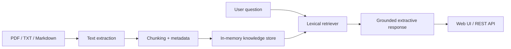

# RAG Knowledge Base Assistant

A local-first document Q&A demo that ingests PDF, Markdown, and text files, retrieves relevant passages, and answers with source references. Built as a small, inspectable starting point for internal knowledge assistants, maintenance manuals, and customer-support knowledge bases.

> **Demo honesty:** This version implements retrieval-augmented, extractive answers using lightweight lexical ranking so it runs without paid APIs or model downloads. It does not claim to generate LLM answers or perform embedding-based semantic search yet. An embeddings/vector database and a local LLM can be added as a later extension.

## Features

- Upload `.txt`, `.md`, and `.pdf` files through the API or browser UI.
- Split documents into overlapping chunks and retain source metadata.
- Retrieve relevant passages using a transparent, dependency-light term scoring algorithm.
- Return an answer assembled from retrieved passages with source names and relevance scores.
- Browser demo UI, health endpoint, request validation, file-size limit, and clear errors.
- Sample documents, automated tests, Docker support, and no API key requirement.

## Quick start

Requires Python 3.11+.

```bash
python -m venv .venv
# macOS/Linux
source .venv/bin/activate
# Windows PowerShell: .venv\Scripts\Activate.ps1

pip install -r requirements.txt
uvicorn app.main:app --reload
```

Open [http://127.0.0.1:8000](http://127.0.0.1:8000) for the demo or [http://127.0.0.1:8000/docs](http://127.0.0.1:8000/docs) for the interactive API docs.

The sample knowledge base is loaded at startup. Upload additional files in the UI, then ask a question. Data is held in memory and resets when the server restarts.

## API overview

| Method | Endpoint | Purpose |
| --- | --- | --- |
| `GET` | `/health` | Health check and document count |
| `GET` | `/documents` | List ingested documents |
| `POST` | `/documents` | Upload a PDF, Markdown, or text file |
| `POST` | `/query` | Retrieve grounded passages for a question |

Example query:

```bash
curl -X POST http://127.0.0.1:8000/query \
  -H "Content-Type: application/json" \
  -d '{"question":"What should I check before restarting a machine?","top_k":3}'
```

Example response shape:

```json
{
  "question": "What should I check before restarting a machine?",
  "answer": "Retrieved context: ...",
  "sources": [
    {
      "source": "maintenance-guide.md",
      "chunk": 1,
      "score": 0.42,
      "text": "..."
    }
  ]
}
```

Scores are relative lexical relevance scores, not calibrated probabilities. Answers should be checked against the cited source text.

## Architecture



## Project structure

```text
app/
  main.py             # FastAPI routes, upload handling, and query pipeline
  static/index.html   # Small browser interface
data/
  sample_docs/        # Synthetic example knowledge documents
tests/
  test_app.py         # API and retrieval tests
requirements.txt
Dockerfile
.env.example
```

## Run tests

```bash
pip install -r requirements.txt
pytest -q
```

## Run with Docker

```bash
docker build -t rag-knowledge-base-assistant .
docker run --rm -p 8000:8000 rag-knowledge-base-assistant
```

Then open [http://localhost:8000](http://localhost:8000).

## Configuration and safety

- `.env.example` documents the optional upload-size setting.
- Files are processed in memory; this demo is not a durable document store.
- Do not upload confidential documents to a public or shared demo.
- PDF parsing depends on text being extractable; scanned PDFs need OCR, which is not included.
- The upload endpoint restricts file extensions and size, but production deployments still need authentication, malware scanning, rate limits, durable storage, and tenant isolation.

## Implemented vs. next steps

**Implemented:** file upload, PDF/text extraction, chunking, lexical retrieval, source citations, UI, API validation, tests, Docker.

**Next steps:** local LLM answer generation with Ollama; embeddings and ChromaDB/pgvector; persistent document storage; OCR; authentication and multi-tenant permissions; evaluation set for retrieval quality.

## License

MIT — see [LICENSE](LICENSE).

## Explore more

- [Advanced Hybrid RAG with Reranking](https://github.com/HardikPaghdar/advanced-hybrid-rag-reranking) — hybrid retrieval and ranking signals.
- [Production RAG Pipeline](https://github.com/HardikPaghdar/production-rag-pipeline) — retrieval, citations, and evaluation.
- [AI Document Intelligence & Extraction](https://github.com/HardikPaghdar/ai-document-intelligence-extraction) — structured document fields.
- [More projects on my portfolio](https://hardikpaghdar.netlify.app/).
